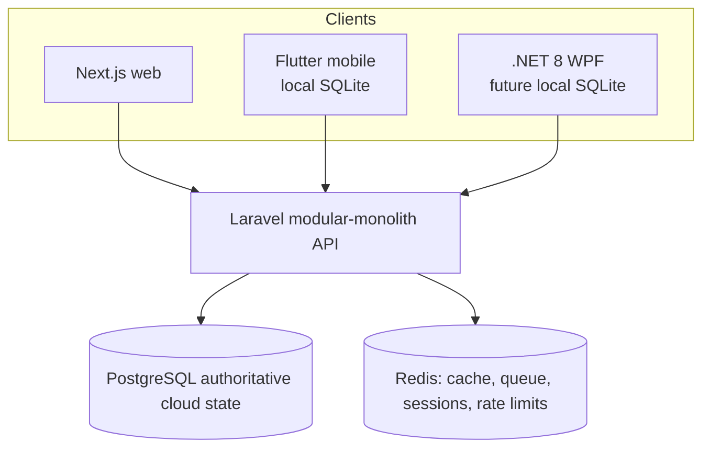

# Container Architecture

Web and API are server components. Mobile and desktop are end-user clients with local working state; their copies and pending operations are not cloud authority. Redis is temporary infrastructure, never business truth.
