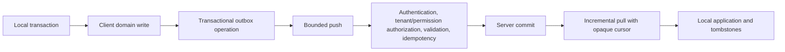

# Offline Sync Architecture

Mobile and desktop/POS are local-first. The target lifecycle is:

`operation_id` is UUIDv7-style durable idempotency identity, not a log correlation ID. Pull uses server ordering and opaque cursors, not timestamp cursors. Editable data may require version conflict workflows; inventory is movement-derived, and finalized financial records use reversals/voids/adjustments rather than generic overwrite/delete. See the detailed [offline documentation](../offline/README.md).

**Current prototype warning:** `SyncEngine` still contains generic CRUD, UUIDv4/timestamp, and replace-on-pull assumptions. It is not the approved production protocol.
