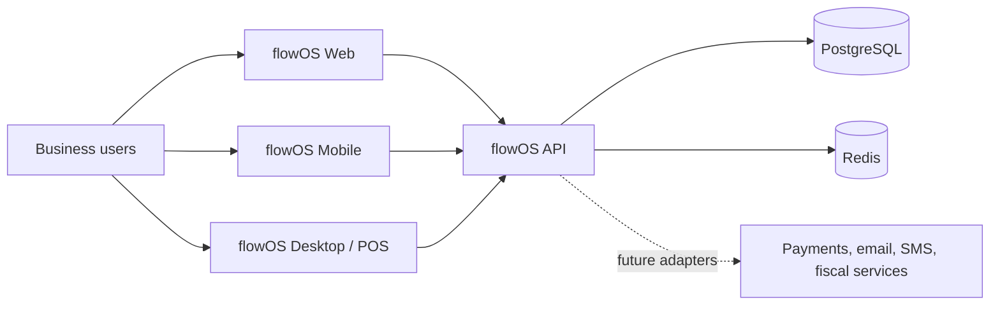

# System Context

Business owners, managers, staff/cashiers, and viewers use flowOS through web, mobile, or desktop clients. A platform operator is a separate future platform-authorization concern, not an organization role.

External services are future adapters behind the API. Clients never connect directly to cloud PostgreSQL or Redis.
