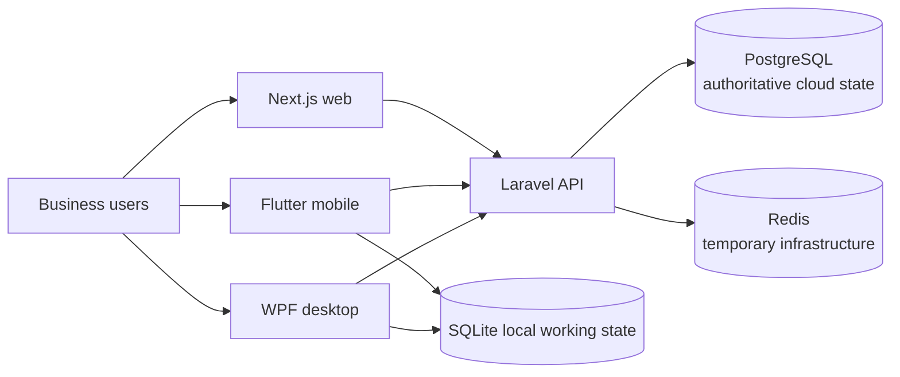

# System Overview

flowOS is an offline-capable, multi-tenant business operating system. It is a modular monolith: one Laravel API provides the authoritative cloud boundary for web, mobile, and desktop clients.

## Current status

Sprint 0 establishes platform foundations, not business modules. The implemented API surface is intentionally limited. Mobile and desktop include offline-oriented prototypes; the target sync protocol is documented in [offline sync architecture](offline-sync-architecture.md) and detailed [offline documentation](../offline/README.md).

## Architectural principles

- PostgreSQL is the authoritative cloud store; Redis is temporary infrastructure only.
- Every tenant-owned cloud record is organization-scoped, and tenant selection never grants access.
- Clients use the API; they never connect directly to cloud PostgreSQL or Redis.
- Financial values are exact and server-authoritative.
- Local working state supports offline work but does not replace server authority after reconciliation.

## Related documents

- [System context](system-context.md)
- [Container architecture](container-architecture.md)
- [Data architecture](data-architecture.md)
- [Architecture boundaries](architecture-boundaries.md)
