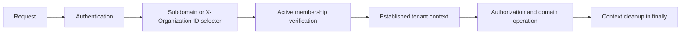

# Tenancy Architecture

An Organization is the tenant; a Branch is an organizational unit within it. flowOS uses one shared PostgreSQL schema with `organization_id` discrimination. It does not use database-per-tenant, schema-per-tenant, or PostgreSQL RLS today.

A selector identifies a candidate only; it never grants access. Tenant-scoped queries use validated tenant context. Cross-tenant access requires an explicit platform purpose and authorization. See [ADR 0023](../adr/0023-shared-schema-tenancy-and-authorization.md).
