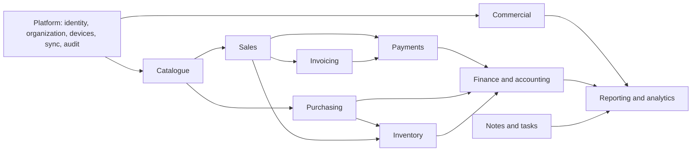

# Domain Map

Arrows describe allowed business relationships, not direct database coupling. Within the modular monolith, domains use `REFERENCE`, `COMMAND`, `DOMAIN EVENT`, or `READ MODEL` interactions. A domain event is an in-process decoupling mechanism, not a microservice broker requirement.

| Boundary | Owns |
|---|---|
| Platform | Identity/access, organizations/branches, devices, sync, audit, configuration, notifications |
| Catalogue | What can be sold or purchased |
| Inventory | Where and how much stock exists through movements |
| Commercial | Customers, suppliers, purchasing, sales/POS, invoices, payments |
| Finance | Expenses, cash/banking, accounting and ledger postings |
| Productivity | Notes and tasks |
| Reporting | Non-authoritative derived read models and analytics |
